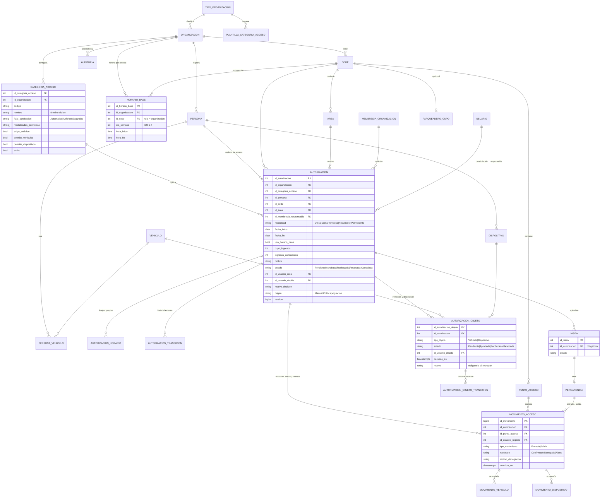

# Modelo unificado de control de accesos

Entregable 1 de la unificación de [[Visitas]] y [[Control de accesos]]. Decisión rectora: [[ADR-029 Registro de acceso unificado]]. Análisis previo: [[Unificación de Visitas y Control de accesos - análisis inicial]]. **Todo es Propuesta** hasta que el usuario confirme este entregable.

## Principios
1. **Un registro de acceso = `autorizacion`.** No se crea `AccessRecord`: se amplía la tabla que ya tiene vigencia, cupo, consumo atómico, incompatibles y transiciones.
2. **`visita` se conserva como episodio** (D-49 resuelta 2026-11-03): ya no se crea desde una pantalla propia; nace al registrar una entrada (o al preanunciar) y siempre apunta a un registro de acceso.
3. **Un solo módulo** `control_accesos`: un menú, `/api/accesos/**`, un formulario. `/visitas`, `/autorizaciones` y `/api/visitas/**` se retiran tras la migración.
4. **Configuración por organización, no por código:** categorías de acceso con terminología, flujo y campos obligatorios; plantillas por tipo de organización.
5. **Objetos con decisión propia** (ADR-026 se mantiene): `autorizacion_objeto` cuelga del registro de acceso.
6. **Intentos fallidos** = `movimiento_acceso` con `resultado = 'Denegado'` y motivos; nunca se abre permanencia.

## Cambios por tabla

| Tabla | Cambio | Estado |
|---|---|---|
| `plantilla_categoria_acceso` | **Nueva** (plataforma): categorías sugeridas por `tipo_organizacion` | Propuesta |
| `categoria_acceso` | **Nueva** (por organización): `codigo`, `nombre` (término visible: Visitante, Invitado, Contratista, Estudiante…), `flujo_aprobacion` (Automatico/Anfitrion/Seguridad, D-52), `modalidades_permitidas text[]`, `exige_anfitrion`, `exige_motivo`, `permite_vehiculos`, `permite_dispositivos`, `activo` | Propuesta |
| `horario_base` | **Nueva**: franjas por día (`id_sede` nulo = organización); varias franjas por día | Propuesta |
| `organizacion` | + `zona_horaria` (por defecto `America/Bogota`); `sede.zona_horaria` pasa a sobrescritura opcional (D-50) | Propuesta |
| `autorizacion` | + `id_categoria_acceso`, `usa_horario_base`, `origen` (Manual/Politica/Migracion), `id_visita_origen`; estados persistidos Pendiente, Aprobada, Rechazada, Revocada, Cancelada (**Vigente/Vencida/Consumida derivadas**); CHECK de motivo en Rechazada/Revocada/Cancelada | Propuesta |
| `autorizacion_horario` | Se elimina la unicidad por día ⇒ varias franjas; CHECK de no solapamiento por exclusión (`btree_gist`) | Propuesta |
| `visita` | `id_autorizacion` obligatorio para filas nuevas (CHECK con fecha de corte); `id_punto_acceso_entrada`; columnas de excepción y política quedan solo como histórico | Propuesta |
| `movimiento_acceso` | `id_autorizacion` obligatorio en filas nuevas; `id_visita`/`id_permanencia` nulos en intentos denegados; + `id_movimiento_objeto[]` no: se usa `movimiento_vehiculo`/`movimiento_dispositivo` con FK al movimiento de la persona | Propuesta |
| `autorizacion_objeto` | `id_autorizacion` obligatorio en filas nuevas; la decisión hereda vigencia del registro salvo que se acote | Propuesta |
| `parqueadero_cupo` | **Nueva, opcional** (módulo `parqueaderos`): cupo por sede (D-54) | Propuesta |
| `auditoria` | + `agente_usuario` (dispositivo); sigue inmutable por trigger | Propuesta |
| `parametro_organizacion` | Claves nuevas: `accesos.fuera_horario` = `Bloquear`/`Alertar` (D-51), `accesos.permite_permanente` (renombra D-42) | Propuesta |

## Diagrama ER

## Estados

**Registro de acceso (persistido):** `Pendiente → Aprobada | Rechazada | Cancelada`; `Aprobada → Revocada | Cancelada`. Motivo obligatorio en Rechazada, Revocada y Cancelada. Flujo `Automatico` ⇒ nace Aprobada con `origen = Politica` y sin decisor humano.

**Vigencia (derivada en cada intento, hora local con zona sede ?? organización):** `NoIniciada`, `Vigente`, `FueraDeHorario`, `Vencida`, `Consumida`. Solo Aprobada + Vigente habilita la entrada. Se muestra en listados con el mismo cálculo del servidor.

**Objeto:** ciclo ADR-026 sin cambios. La entrada de la persona no exige que sus objetos estén aprobados; el objeto se registra en el movimiento solo si está Aprobado y vigente (D-53, Propuesta).

## Configuración por tipo de organización (Propuesta)

| Tipo | Categorías sugeridas (término visible) | Flujo por defecto |
|---|---|---|
| Empresa | Visitante, Contratista, Proveedor | Anfitrión |
| Conjunto residencial | Visitante, Domiciliario, Trabajador | Anfitrión (residente) |
| Club | Invitado, Socio, Proveedor | Seguridad |
| Universidad | Visitante, Estudiante externo, Contratista | Seguridad |
| Coworking | Invitado, Miembro, Proveedor | Automático |
| Parque industrial | Contratista, Transportador, Visitante | Seguridad |

Al crear la organización se copian las plantillas; la organización las edita sin tocar el núcleo.

## Endpoints previstos (`/api/accesos`)
`GET /` (filtros + paginación) · `GET /{id}` · `GET /opciones` · `POST /` (persona + destino + categoría + permanencia + horario + objetos) · `POST /{id}/aprobar|rechazar|revocar|cancelar` · `POST /{id}/objetos/{idObjeto}/aprobar|rechazar|revocar` · `POST /{id}/entrada`, `POST /permanencias/{id}/salida` (Idempotency-Key) · `GET /presencia` · `GET /historial` + `GET /historial/exportar?formato=csv`.

## Migración de datos (resumen; detalle en Fase 2)
1. Crear `categoria_acceso` por organización desde plantillas; categoría «Visitante» y «Acceso recurrente» para lo existente.
2. `autorizacion` existentes ⇒ categoría según modalidad (Recurrente/Permanente ⇒ «Acceso recurrente»; resto ⇒ «Visitante»), `origen = Manual`.
3. `visita` sin autorización ⇒ crear `autorizacion` Única con la sede, destino, responsable y fecha de la visita, `origen = Migracion`; estado: política aplicada ⇒ Aprobada sin decisor; Pendiente ⇒ Pendiente; Rechazada/Cancelada/Vencida ⇒ Rechazada/Cancelada con motivo «Migrado desde visita #id». Se enlaza la visita y su transición inicial.
4. `movimiento_acceso.id_autorizacion` ⇐ `visita.id_autorizacion` cuando falte.
5. `autorizacion_objeto` sin `id_autorizacion` se conservan como históricos (nulo permitido antes de la fecha de corte).
6. Bitácora `public.migracion_accesos_adr029` con cada fila creada o no trasladable; auditoría `Migrar` por registro. No se borra ninguna tabla ni columna.
7. Verificación: conteos antes/después de visitas, movimientos y permanencias iguales; toda visita con autorización.

## Fase 2: migración implementada (2026-11-03)

Migración `20261103163234_RegistroAccesoUnificado` (rama `feature/organizaciones`). **Implementado y verificado sobre copia desechable; no aplicada a `conecsia`.**

- **Esquema:** tablas `plantilla_categoria_acceso`, `categoria_acceso`, `horario_base`; `organizacion.zona_horaria` (por defecto `America/Bogota`); `autorizacion.id_categoria_acceso`, `usa_horario_base`, `origen` (CHECK), `id_visita_origen` (FK a visita); `auditoria.agente_usuario` + índices de historial; FK `movimiento_acceso → autorizacion`; `autorizacion_horario` admite varias franjas por día.
- **Datos:** 6 tipos de organización (se crean los que faltan), 19 plantillas, categorías copiadas a cada organización (+ VISITANTE y RECURRENTE garantizadas); autorizaciones existentes categorizadas por modalidad; cada visita sin autorización ⇒ autorización Única `origen = Migracion` con transición, vínculo en la visita y sus movimientos, auditoría `Migrar` y fila en `migracion_accesos_adr029`; `accesos.permite_permanente` copia la clave anterior.
- **Diferido a Fase 3 (con el código):** `id_categoria_acceso` NOT NULL, `visita.id_autorizacion` obligatorio, CHECK de motivo en Rechazada/Revocada/Cancelada, `parqueadero_cupo` (D-54), retiro de rutas de menú. La zona horaria de la sede se conserva como está (obligatoria); la de la organización se usará como valor por defecto al crear sedes (D-50).
- **Verificación:** copia de la base Docker: 0 visitas sin autorización, bitácora y auditoría correctas; Down → Up reversible (la auditoría inmutable se conserva); `dotnet test` **104/104**.
